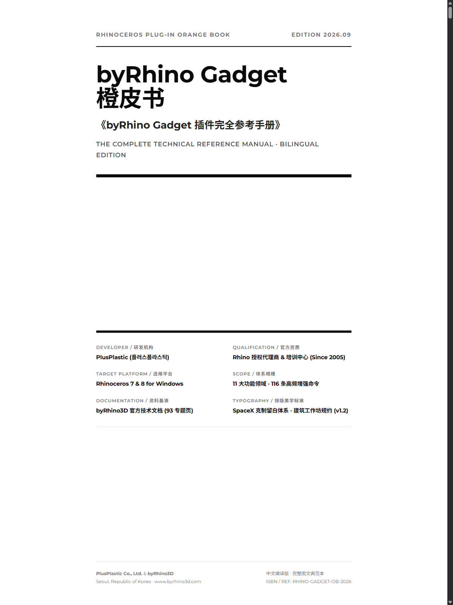

# byRhino Gadget · 橙皮书

**Rhinoceros 7 / 8 · 中文图解参考手册**  
*Chinese Illustrated Reference Manual · Edited by 有物建筑 / MeansGroup*

> 从命令查找，到具体操作，再到实际建模工作流。以清晰、可检索的中文图解，系统整理 byRhino Gadget 工具的使用方法。

[**📖 阅读 / 下载最新版橙皮书（PDF）**](./byRhinoGadget_Orange_Book_v2.pdf)　·　[**下载 HTML 阅读版**](./byRhinoGadget_Orange_Book_v2.html)　·　[插件官方网站](https://www.byrhino3d.com/)

## 内页预览 · Inside the book

清晰的命令分组、操作步骤、参数解释与图解示例。点击图片可阅读完整手册。

> 更多内页图片以完整 PDF 为准；本仓库主要提供成品文档，不附带制作与编译过程文件。

## 获取手册 · Downloads

| 版本 | 页数 | 文件 | 适合场景 |
| --- | ---: | --- | --- |
| **橙皮书 v2 · 典范版（推荐）** | **145** | [PDF](./byRhinoGadget_Orange_Book_v2.pdf) · [HTML](./byRhinoGadget_Orange_Book_v2.html) | 电子阅读、章节导航、图文检索与打印 |
| byRhino Gadget 101 · 探索版 | 139 | [PDF](./byRhinoGadget_101.pdf) · [HTML](./byRhinoGadget_101.html) | 浏览早期排版与内容组织 |
| 橙皮书 · 白底经典版 | 119 | [PDF](./byRhinoGadget_Orange_Book.pdf) · [HTML](./byRhinoGadget_Orange_Book.html) | 偏好简洁黑白排版、办公打印 |

**建议优先下载 v2 PDF。** PDF 内含目录、命令索引、图文操作步骤和页面跳转链接。HTML 版本需要同时保留仓库内的 `assets/` 图像资源，才能完整呈现插图。

## 内容概览 · What's inside

- **116 条增强命令**：覆盖控制点、曲线、曲面、实体、标注出图、图层管理、空间变换、建模细节、显示设置及分析测算等。
- **472 幅操作图解**：按功能提供关键步骤与相关参数的阅读参考。
- **典型建模工作流**：将独立命令串联为可复用的设计与工程操作流程。
- **检索体系**：章节目录、命令总览、术语对照与 A–Z 命令索引。

本书为 **byRhino Gadget 插件的中文参考手册**，不是插件安装程序。插件的版本兼容性、安装方式和最新功能请以[开发者官方页面](https://www.byrhino3d.com/byRhinoGadget/help/index.html)为准。

## 版权与致谢 · Credits

- **插件研发及原始技术文档**：PlusPlastic Co., Ltd.（플러스플라스틱）／[byRhino3D](https://www.byrhino3d.com/)
- **中文版编译与编辑设计**：[有物建筑 · MeansGroup](https://means.group)
- **商标**：Rhinoceros / Rhino 及其相关标志归各自权利人所有。

本文档为中文编辑整理作品，并非 PlusPlastic 或 McNeel 官方发布的插件安装包；原始资料与产品权利归相应权利人所有。
